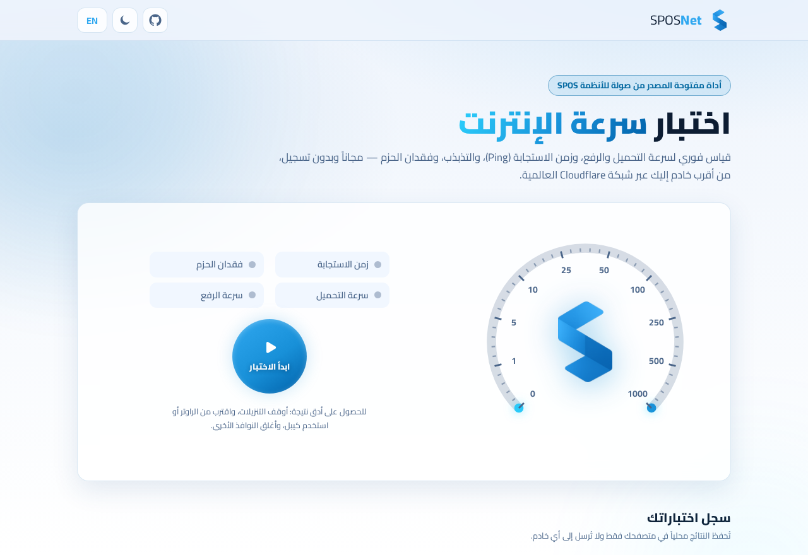
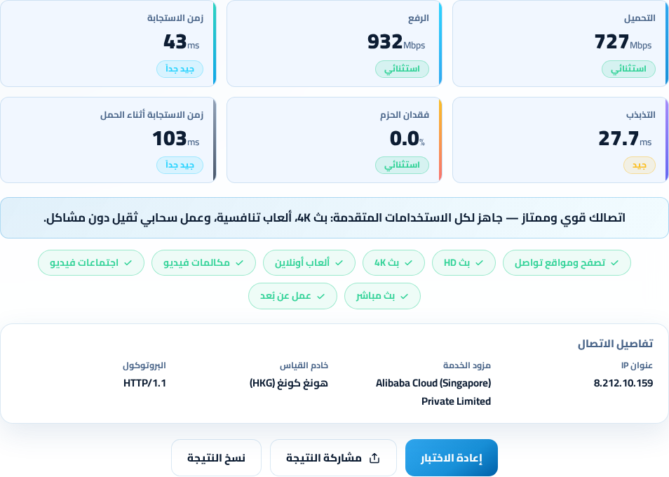

<div align="center">


# SPOS Net — اختبار سرعة الإنترنت

**أداة قياس سرعة إنترنت مفتوحة المصدر: التحميل، الرفع، زمن الاستجابة، التذبذب، وفقدان الحزم — بلا خادم، بلا تبعيات، بلا تتبع.**

[](https://spos-systems.github.io/SPOS-Net/)
[](LICENSE)
[](#)
[](#english)
[](manifest.webmanifest)

**[تجربة مباشرة — Live Demo](https://spos-systems.github.io/SPOS-Net/)** · **[الأسئلة الشائعة](https://spos-systems.github.io/SPOS-Net/#faq)** · **[الموقع الرسمي SPOS](https://spos.ly)**

</div>

---

## المحتويات

- [لماذا SPOS Net؟](#لماذا-spos-net)
- [المميزات](#المميزات)
- [لقطات الشاشة](#لقطات-الشاشة)
- [كيف يعمل القياس؟](#كيف-يعمل-القياس)
- [الاستضافة الذاتية](#الاستضافة-الذاتية)
- [هيكل المشروع](#هيكل-المشروع)
- [التطوير محلياً](#التطوير-محليا)
- [المساهمة](#المساهمة)
- [الرخصة](#الرخصة)
- [الاعتمادات](#الاعتمادات)

## لماذا SPOS Net؟

أدوات قياس السرعة العالمية مليئة بالإعلانات والتتبع والواجهات المزدحمة. **SPOS Net** بُني ليكون العكس تماماً: أداة عربية أولاً، سريعة كالبرق، صادقة في منهجيتها، مفتوحة المصدر بالكامل — منافسة جادة لـ Speedtest و Cloudflare Speed Test و Fast.com في الجودة، ومختلفة عنها في الفلسفة.

## المميزات

- **قياس شامل**: سرعة التحميل والرفع، زمن الاستجابة (Ping)، التذبذب (Jitter)، فقدان الحزم، وزمن الاستجابة أثناء الحمل (Loaded Latency).
- **عدّاد سرعة تفاعلي** بمقياس غير خطي (0 → 1000 ميغابت) ورسم بياني مباشر لثبات السرعة.
- **تقييم فوري لاتصالك**: جاهزيتك للبث 4K/HD، الألعاب التنافسية، المكالمات والاجتماعات، البث المباشر، والعمل عن بُعد.
- **تفاصيل الاتصال**: عنوان IP، مزود الخدمة، أقرب خادم قياس (أكثر من 330 مدينة عبر شبكة Cloudflare)، والبروتوكول المستخدم.
- **سجل اختبارات محلي** في متصفحك فقط — لا يُرفع أي شيء إلى أي خادم.
- **مشاركة بنقرة واحدة** عبر مشاركة النظام أو واتساب أو النسخ.
- **ثنائي اللغة والاتجاه**: عربي RTL افتراضياً مع تبديل كامل إلى English LTR.
- **مظهر داكن/فاتح** بألوان الهوية الزرقاء، مع دعم `prefers-color-scheme`.
- **PWA قابل للتثبيت**: يعمل كتطبيق مستقل مع دعم أوفلاين لواجهة الأداة.
- **وصولية (a11y)**: تنقل بلوحة المفاتيح، منطقة قراءة حية للقارئات، تباين ألوان عالٍ، ودعم تقليل الحركة.
- **أداء خالص**: صفر تبعيات، صفر إطار عمل، الخطوط مستضافة محلياً — حجم الموقع كاملاً أقل من ملف صورة واحدة في مواقع المنافسين.
- **SEO/GEO كامل**: بيانات منظمة (WebApplication, Organization, FAQPage, HowTo)، خريطة موقع، robots.txt، وOpen Graph كامل بصورة مشاركة مخصصة.

## لقطات الشاشة

| الاختبار والعدّاد | النتائج والتقييم |
|:---:|:---:|
|  |  |

> كل اللقطات من الإصدار الفعلي — الموقع يعمل بنفس الشكل على الجوال والحاسوب.

## كيف يعمل القياس؟

شفافية كاملة — لا سحر ولا أرقام مخفية:

| المقياس | الطريقة | المدة التقريبية |
|---|---|---|
| زمن الاستجابة (Ping) | 12 طلباً صغيراً متتالياً بعد تسخين الاتصال (يُحسب المتوسط والأدنى والأقصى) | ~2 ث |
| التذبذب (Jitter) | متوسط الفروق المطلقة بين استجابات متتالية | مع البنق |
| فقدان الحزم | 60 طلباً صغيراً على 6 دفعات متزامنة؛ الفشل أو انتهاء المهلة = حزمة مفقودة (تقدير HTTP لأن المتصفح لا يرسل ICMP) | ~2 ث |
| سرعة التحميل | 5 اتصالات متوازية من `speed.cloudflare.com/__down` بحجم يتكيف مع سرعتك، مع تجاهل أول 1.5 ثانية (مرحلة التسارع) | ~9 ث |
| سرعة الرفع | 3 اتصالات متوازية POST إلى `speed.cloudflare.com/__up` ببيانات عشوائية حقيقية | ~8 ث |
| الاستجابة أثناء الحمل | مجسات صغيرة أثناء إشباع الخط لكشف الازدحام (Bufferbloat) | أثناء التحميل/الرفع |

نقاط القياس هي نقاط نهاية عامة مفتوحة (CORS) من شبكة Cloudflare، ولا تتطلب أي مفتاح أو تسجيل. لقراءة موسعة عن تفسير النتائج زر [قسم "افهم نتائجك"](https://spos-systems.github.io/SPOS-Net/#guide) في الموقع.

## الاستضافة الذاتية

الموقع ملفات ثابتة بحتة — يعمل على أي مستضيف:

**عبر GitHub Pages (دقيقتان):**

1. اعمل Fork لهذا المستودع.
2. من إعدادات المستودع: Settings ← Pages ← Source: `main` / `/ (root)`.
3. افتح `https://<username>.github.io/SPOS-Net/` — انتهى.

> مهم: حدّث الروابط المطلقة (`canonical`، `og:url`، خريطة الموقع في `robots.txt` و `sitemap.xml` وبيانات JSON-LD) إلى نطاقك الجديد إذا استضفته على نطاق مختلف.

**على أي مستضيف ثابت آخر:** انسخ محتويات المستودع كما هي (Netlify، Vercel، Cloudflare Pages، Apache، Nginx...). لا خطوة بناء، لا `npm install`.

## هيكل المشروع

```
SPOS-Net/
├── index.html                 # الصفحة الوحيدة — كود HTML نظيف مع SEO/GEO كامل
├── 404.html                   # صفحة الخطأ
├── manifest.webmanifest       # بيانات تطبيق PWA
├── sw.js                      # Service Worker (كاش الواجهة للأوفلاين)
├── robots.txt · sitemap.xml   # ملفات الزحف
├── favicon.ico
├── assets/
│   ├── css/style.css          # التنسيق كاملاً — بدون أي مكتبة
│   ├── js/
│   │   ├── i18n.js            # قاموس عربي/إنجليزي كامل
│   │   ├── engine.js          # محرك القياس (تحميل/رفع/بنق/فقدان)
│   │   ├── gauge.js           # العدّاد SVG + الرسم البياني Canvas
│   │   └── app.js             # تدفق التطبيق والنتائج والسجل والمشاركة
│   ├── fonts/                 # خط Cairo (مستضاف محلياً — 63KB فقط)
│   └── img/                   # الشعار والأيقونات وصورة OG
├── docs/screenshots/          # لقطات الشاشة
└── .github/                   # قوالب الإصدارات والطلبات + سير عمل CI
```

## التطوير محلياً

```bash
git clone https://github.com/spos-systems/SPOS-Net.git
cd SPOS-Net
python3 -m http.server 8080   # أو أي خادم ملفات ثابت
# افتح http://localhost:8080
```

لا توجد خطوة بناء إطلاقاً — ما تراه هو ما يشغّله المستخدم.

## المساهمة

المساهمات مرحب بها بحرارة! اقرأ [CONTRIBUTING.md](CONTRIBUTING.md) للتفاصيل. أفكار نرحب بها خصوصاً:

- دعم لغات جديدة (أضف قاموساً في `assets/js/i18n.js`)
- تحسينات دقة القياس ومنهجيته
- دعم خوادم قياس بديلة/قابلة للاختيار
- تحسينات الوصولية والأداء

## الرخصة

مشروع مرخص تحت [رخصة MIT](LICENSE) — استخدمه، عدّله، وانشره بحرية.

## الاعتمادات

<div align="center">

**تطوير: [صولة للأنظمة — SPOS](https://spos.ly)**

حلول برمجية متكاملة — من الفكرة إلى الإطلاق

[الموقع](https://spos.ly) · [واتساب](https://wa.me/218935535606) · ‎+218 93 553 5606 · [GitHub](https://github.com/spos-systems)

</div>

---

# English

**SPOS Net** is an open-source internet speed test: download, upload, latency, jitter and packet loss — no backend, no dependencies, no tracking. Arabic-first (full RTL) with a complete English interface, installable as a PWA, and built to compete with Speedtest / Cloudflare / Fast.com on quality while staying radically lighter and more transparent.

**[Live Demo](https://spos-systems.github.io/SPOS-Net/)**

### Highlights

- Full metric set: download, upload, ping, jitter, packet loss and latency under load
- Interactive non-linear gauge (0→1000 Mbps) plus a live throughput chart
- Instant readiness rating for 4K/HD streaming, competitive gaming, calls, meetings, live streaming and remote work
- Connection details: IP, ISP, nearest test server (330+ cities via Cloudflare), protocol
- Local-only test history (localStorage), one-click sharing, dark/light themes, a11y & reduced-motion support
- Zero dependencies, zero build step, self-hosted fonts (~63 KB) — the whole site is lighter than a single screenshot of the competitors
- Full SEO/GEO: JSON-LD (WebApplication, Organization, FAQPage, HowTo), sitemap, robots, Open Graph image

### Methodology (short)

Latency/jitter via sequential tiny requests; packet loss estimated via 60 small HTTP requests in concurrent batches (browsers cannot send ICMP); download via 5 adaptive parallel streams to `speed.cloudflare.com/__down` discarding the 1.5s ramp-up; upload via 3 parallel POSTs to `speed.cloudflare.com/__up`; latency-under-load probes during saturation. Public, key-less, CORS-enabled endpoints.

### Self-hosting

Fork → Settings → Pages → deploy `main` from root. Or drop the files on any static host (Netlify / Vercel / Cloudflare Pages / nginx). No build step. Update absolute URLs (`canonical`, `og:url`, `sitemap.xml`, JSON-LD) if you use a custom domain.

### Contributing & License

See [CONTRIBUTING.md](CONTRIBUTING.md). Released under the [MIT License](LICENSE). Built by **[Solut Systems — SPOS](https://spos.ly)**, Libya.
