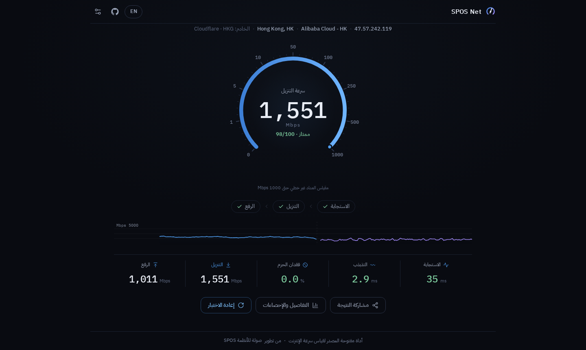
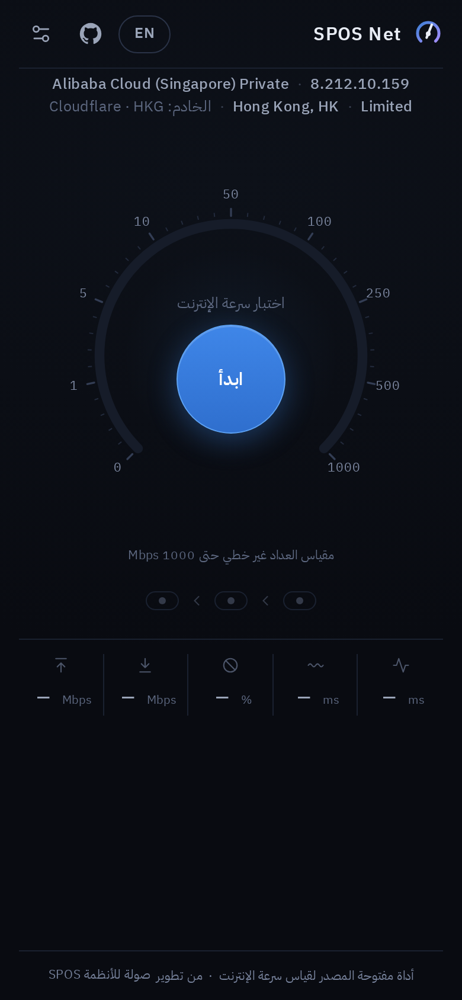

# SPOS Net

**اختبار سرعة إنترنت مفتوح المصدر — An open-source internet speed test**

قياس احترافي كامل: سرعة التنزيل والرفع، زمن الاستجابة (خامل وأثناء الحمل)، التذبذب، وفقدان الحزم التقديري — مع رسم بياني حي، درجة Bufferbloat، وخيارات متقدمة ومشاركة وتصدير النتائج.

A complete professional measurement: download and upload speed, latency (idle and under load), jitter and estimated packet loss — with a live speed graph, a bufferbloat grade, advanced options, sharing and export.

**الرابط / Live**: <https://spos-systems.github.io/SPOS-Net/>

---

## المزايا | Features

| | |
|---|---|
| سرعة التنزيل والرفع | تدفقات HTTP متوازية مع استبعاد مرحلة التسارع وحساب المتوسط والذروة وثبات التنزيل |
| رسم بياني حي | مخطط فوري لسرعة التنزيل والرفع أثناء الاختبار |
| زمن الاستجابة | أدنى / وسيط / متوسط / أقصى (زمن أول بايت) |
| التذبذب | متوسط الفروق بين العينات المتتالية |
| فقدان الحزم | تقدير عبر دفعة طلبات قصيرة (تقدير HTTP) |
| الاستجابة أثناء الحمل | درجة Bufferbloat من A+ إلى F مع مقدار الزيادة |
| خيارات احترافية | الوحدة، مدة المراحل (8/12/20 ث)، عدد الاتصالات (1–16)، مفاتيح تفعيل |
| المشاركة والتصدير | رابط نتيجة، ملخص نصي، صورة PNG، ملف JSON، واتساب / X / تيليجرام، مشاركة نظامية |
| معلومات الاتصال | IP، المزود/ASN، المدينة، نقطة Cloudflare، البروتوكول |
| تقييم الاتصال | درجة 0–100 + خلاصة بشرية + ملاءمة الاستخدام (بث 4K، مكالمات، ألعاب…) |
| سجل النتائج | آخر 10 اختبارات محلياً في المتصفح فقط |
| اختصارات ومعاملات | `Space` بدء/إيقاف · `S` الإعدادات · `D` التفاصيل · `?lang=ar\|en` · `?auto=1` بدء تلقائي |
| تثبيت ولغة | PWA قابل للتثبيت، وتعرّف تلقائي على لغة المتصفح في الزيارة الأولى |

Zero dependencies · No build step · No ads · No tracking · MIT license

## الصفحة | Screenshots

<p align="center">
  
  <br>
  
  <br>
  
</p>

## كيف يعمل؟ | How it works

الموقع ثابت بالكامل (HTML/CSS/JS بدون أي مكتبات) ويجري كل القياسات من متصفح الزائر نحو نقاط قياس Cloudflare العامة المفعّل بها CORS:

- `GET /__down?bytes=N` — تنزيل واستجابة
- `POST /__up` — رفع
- `GET /meta` — معلومات الاتصال (مع بديل احتياطي عبر ترويسات `cf-meta-*`)

لا حسابات، لا إعلانات، لا تسجيل على الخادم — والسجل والإعدادات لا تغادر المتصفح. التفاصيل الكاملة في [llms-full.txt](llms-full.txt).

### معاملات URL | URL parameters

| المعامل | الوصف |
|---|---|
| `?lang=ar` أو `?lang=en` | فتح الأداة بلغة محددة |
| `?auto=1` | بدء الاختبار تلقائياً بعد التحميل (أكشاك / تضمين) |
| `#r=…` | رابط نتيجة مشارَكة (ينشئه زر المشاركة) |

## التشغيل محلياً | Run locally

```bash
git clone https://github.com/spos-systems/SPOS-Net.git
cd SPOS-Net
python3 -m http.server 8000
# open http://localhost:8000
```

## البنية | Structure

```
index.html              الصفحة الوحيدة (شاشة واحدة)
assets/css/style.css    نظام التصميم
assets/css/fonts.css    خطوط ذاتية الاستضافة (IBM Plex)
assets/js/engine.js     محرك القياس
assets/js/gauge.js      العداد الدائري (SVG)
assets/js/i18n.js       العربية / English
assets/js/app.js        واجهة التحكم
llms.txt, llms-full.txt توثيق لمحرّكات الذكاء الاصطناعي (GEO)
```

## المساهمة | Contributing

انظر [CONTRIBUTING.md](CONTRIBUTING.md). التقارير الأمنية في [SECURITY.md](SECURITY.md).

## الترخيص | License

[MIT](LICENSE) © SPOS — [صولة للأنظمة](https://spos.ly)

<p align="center"><sub>من تطوير صولة للأنظمة SPOS · spos.ly</sub></p>
